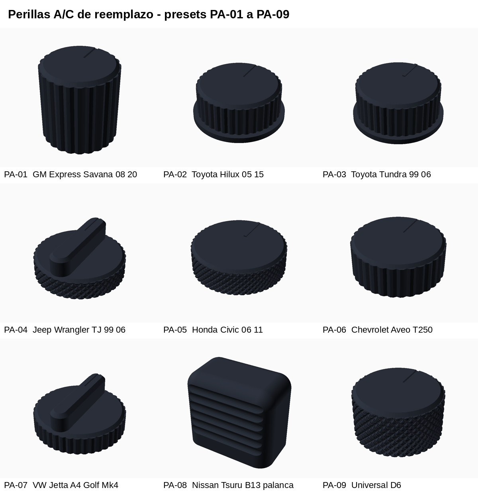
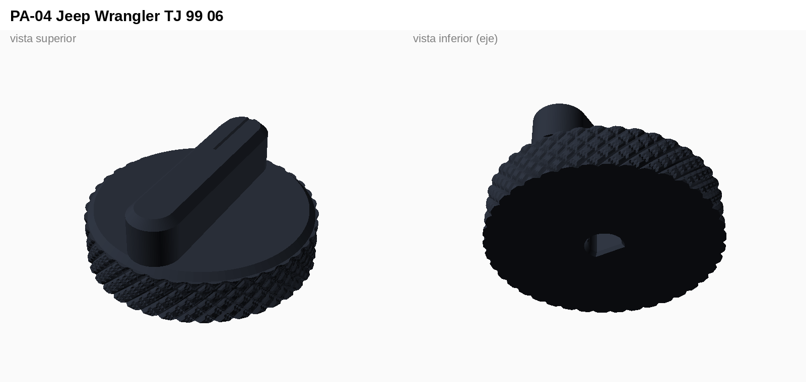
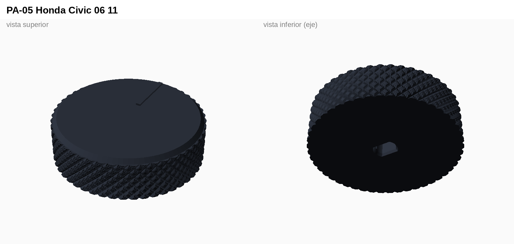
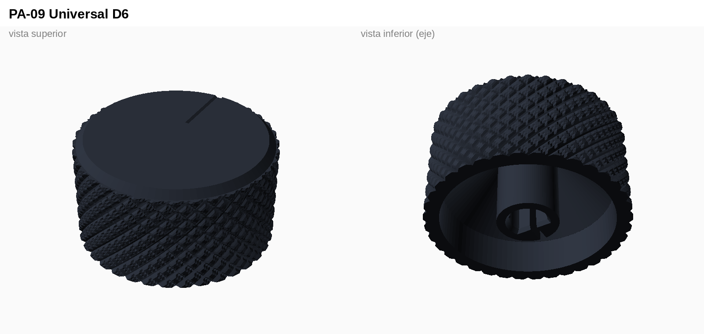
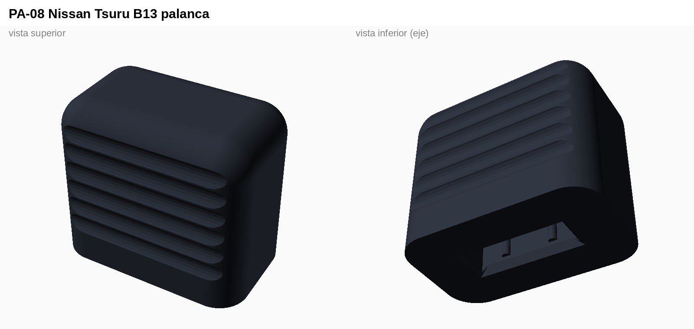
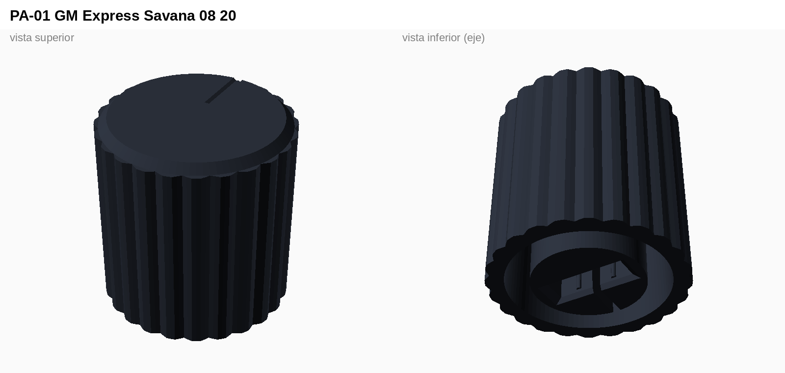
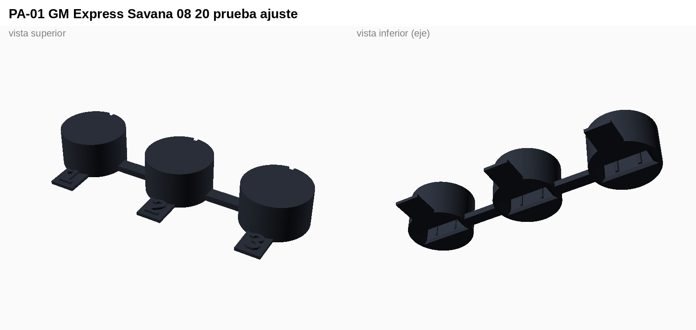

# Perillas de aire acondicionado de reemplazo paramétricas

**Diseño original de Fleremias** · CAD paramétrico en OpenSCAD · Versión 1.0 · 2026-10-15

Generador para reponer las **perillas y manillas del aire acondicionado y la ventilación** que se rompen, se cristalizan con el sol o se pelan en autos de más de 10 años. Trae 9 presets de partida, acepta casi cualquier tipo de eje y genera una **probeta de ajuste** para acertar la medida antes de imprimir la perilla final.

| | |
|---|---|
| Método | CAD paramétrico por código (OpenSCAD, geometría sólida constructiva) |
| Configurador | Customizer de OpenSCAD (2021.01 o posterior) |
| Ejes soportados | D, doble D, estriado, pala (rectangular), cruz y redondo |
| Material | **ASA recomendado** (aguanta ~100 °C y UV); PETG solo para autos con sombra o como prueba |
| Impresión | Sin soportes, capa 0,16 mm, 4 paredes, relleno 40 % giroide |
| Impresoras | Creality K2 Plus Combo (ASA, cámara cerrada) · SPARKX i7 (PETG) |
| Laminador | Creality Print |
| Licencia | [CC BY-NC-SA 4.0](LICENSE) |

## ⚠️ Medidas con fuente vs estimadas

Los fabricantes no publican las medidas de los ejes. **Solo el preset PA-01 tiene medidas con fuente** (ficha Dorman 76834). Los otros ocho son **estimados**: antes de vender o instalar, mide el eje del auto real e imprime la prueba de ajuste.

## Estructura del repositorio

| Carpeta | Contenido |
|---|---|
| [`01_codigo_cad/`](01_codigo_cad/) | `perilla_ac_parametrica.scad`, el generador completo (sin librerías externas) |
| [`02_modelos_stl/`](02_modelos_stl/) | Perilla final de cada preset, lista para imprimir (GitHub las muestra en 3D al abrirlas) |
| [`03_pruebas_ajuste_stl/`](03_pruebas_ajuste_stl/) | Probeta de cada preset: 3 anillos cortos numerados con holgura −0,1 / 0 / +0,1 mm |
| [`04_renders/`](04_renders/) | Resumen de presets y vista de cada perilla y su probeta |
| [`05_documentacion/`](05_documentacion/) | [LEEME](05_documentacion/LEEME.md) con guía de medición, impresión y fuentes, y su versión en [PDF](05_documentacion/FLM-PA_guia-medicion-y-presets.pdf) |

### Presets

| Código | Auto | Forma y eje | Medidas (mm) | Origen |
|---|---|---|---|---|
| PA-01 | Chevrolet Express / GMC Savana 2008-2020 | Redonda · eje pala 10,9 × 3,8 | 27,9 × 27,9 × 28,7 | **Con fuente** (Dorman 76834) |
| PA-02 | Toyota Hilux 2005-2015 | Redonda con faldón · eje D 6 | 40 × 40 × 16 | Estimado |
| PA-03 | Toyota Tundra 1999-2006 | Redonda con faldón · eje D 6 | 42 × 42 × 18,6 | Estimado |
| PA-04 | Jeep Wrangler TJ 1999-2006 | Disco con aleta · eje D 6 | 44 × 44 × 19 | Estimado |
| PA-05 | Honda Civic 2006-2011 | Disco moleteado · eje doble D | 46 × 46 × 13,6 | Estimado |
| PA-06 | Chevrolet Aveo T250 / Sail | Redonda · eje estriado 18 dientes | 40 × 40 × 15 | Estimado |
| PA-07 | VW Jetta A4 / Golf Mk4 (Climatic manual) | Disco con aleta · eje D 6 | 40 × 40 × 17 | Estimado |
| PA-08 | Nissan Tsuru B13 (palancas deslizantes) | Cubre-palanca · ranura 8 × 2,4 | 16 × 10 × 14 | Estimado |
| PA-09 | Universal | Redonda moleteada · eje D 6 | 34 × 34 × 18 | Eje D 6 mm genérico |

Todas las mallas están cerradas (*watertight*).

## Arquitectura del modelo

- `perfil_eje()` / `agujero_eje()`: perfil 2D del eje (D, doble D, estriado, pala, cruz o redondo) con holgura, costillas de presión de 0,2 mm y entrada achaflanada.
- `manga()`: superficie lateral lisa, con estrías o con moleteado de diamante.
- `indicador_sup()`: marca de posición en ranura (para pintar o rellenar con 2º color) o en relieve.
- `cuerpo_redondo()` / `perilla()`: cuerpo con faldón opcional, aleta tipo barra y versión hueca con buje partido. Si la perilla es muy baja y ancha se vuelve sólida sola para no imprimir techos en voladizo.
- `cubre_palanca()`: funda para manillas deslizantes.
- `prueba_ajuste()` / `etiqueta()`: los tres anillos numerados para calibrar la holgura.

### Pestañas del Customizer

| Pestaña | Parámetros |
|---|---|
| 1. Qué imprimir | `preset`, `pieza` (perilla o prueba de ajuste) |
| 2. Cuerpo | Estilo (redonda, barra, cubre-palanca), diámetro, alto, faldón, chaflán, hueca, pared y techo |
| 3. Agarre | Textura (ninguna, estrías, moleteado), cantidad y profundidad; ancho y alto de la aleta |
| 4. Indicador | Ranura, relieve o ninguno, y su ángulo |
| 5. Eje del tablero | Tipo, diámetro, cara plana, pala, estrías, profundidad, giro y `holgura` |
| 6. Cubre-palanca | Medidas de la funda y de la ranura de la palanca |

## Cómo usarlo

1. **Mide** con pie de metro el eje del tablero o el agujero de la perilla rota (diámetro, cara plana, dientes, profundidad) y la perilla original.
2. Abre `01_codigo_cad/perilla_ac_parametrica.scad` en [OpenSCAD](https://openscad.org/), activa *Ventana → Customizer*, elige el preset más parecido y corrige las medidas.
3. Exporta `pieza = prueba_ajuste` (≈10 min de impresión) y prueba los tres anillos en el auto. Anillo 1 = holgura −0,1; anillo 3 = +0,1. Si todos quedan sueltos o apretados, cambia `holgura` en 0,2 y repite.
4. Exporta la perilla final con esa holgura (F6 y *Archivo → Exportar → STL*).
5. Imprime en ASA, con la boca del eje apoyada en la cama y sin soportes.

Guía completa de medición, ajustes de impresión, causas de rotura y fuentes: [LEEME](05_documentacion/LEEME.md).

## Galería

| | |
|---|---|
|  |  |
|  |  |
|  |  |

## Autoría y licencia

Diseño, modelado CAD y documentación: **Fleremias** ([@fleremiasflemin20-maker](https://github.com/fleremiasflemin20-maker)).
También disponible en la [Biblioteca 3D](https://github.com/fleremiasflemin20-maker/biblioteca-3d).

Publicado bajo [Creative Commons Atribución-NoComercial-CompartirIgual 4.0](LICENSE). Puedes imprimirlo y modificarlo para uso personal citando al autor. La venta de piezas impresas o de versiones derivadas requiere permiso de Fleremias.
